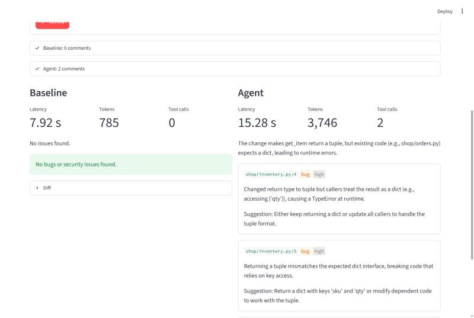
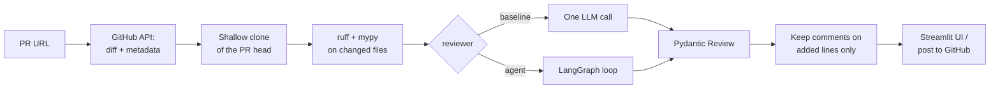
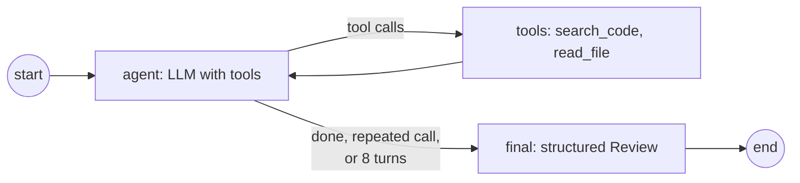

# PR Review Agent

[](https://github.com/gokulred/pr-review-agent/actions/workflows/ci.yml)

An LLM agent that reviews Python pull requests for **bugs and security issues**. It runs ruff and mypy, then uses LangGraph tool calls to search the repository for the code a PR depends on, so it can catch bugs that only show up in a file the PR didn't touch.

Every design change was measured against a set of pull requests with planted bugs, comparing the agent with a single-prompt baseline.


## Demo


https://github.com/user-attachments/assets/a7ad9bb6-4f33-4846-abc2-c0aceee387ac


## Results

10 pull requests, one planted bug each, every PR reviewed 3 times by each reviewer, using `openai/gpt-oss-120b` on Groq:

| reviewer | bugs caught | false positives / run | avg latency | avg tokens | avg tool calls |
|---|---|---|---|---|---|
| single-prompt baseline | **6.0 / 10** | 0 | 10.6 s | 916 | 0 |
| LangGraph agent | **9.3 / 10** | 0 | 19.7 s | 3,771 | 2.1 |

- **Same-file bugs (5 PRs):** an off-by-one, a missing empty-list check, SQL injection, a hardcoded secret, and catching the wrong exception. Both reviewers catch all of them.
- **Cross-file bugs (5 PRs):** the PR changes a function and breaks a caller in another file: a changed return type, a units change, a rename, swapped arguments, and renamed dictionary keys. **The agent catches 4.3 / 5, the baseline 1.0 / 5**, because only the agent can go and look at the callers.
- **Cost:** about 4× the tokens and 2× the latency of the baseline. Latencies include waiting out free-tier rate limits.
- **Scoring:** a catch is a comment on one of the lines the planted bug changed. Every other comment is a false positive, including a second comment about the same bug. A failed run counts as a miss.

The planted bugs are in [`evals/ground_truth.yaml`](evals/ground_truth.yaml) and the PRs in [gokulred/review-sandbox](https://github.com/gokulred/review-sandbox/pulls). Every comment from every run is saved in [`evals/results.json`](evals/results.json).

## How it works



The agent loop:



Both reviewers get the same prompt and the same diff, so the comparison is fair. The only difference is that the agent can read and search the checked-out repo before it answers.

## Engineering decisions

- **Eval first.** The baseline was built and measured before the agent, and every change after that was checked against the eval. It caught a real regression: adding the prompt-injection defence cut the agent's tool use in half and its score fell from 9.3 to 8.3. Restructuring the instructions into explicit steps (find every caller of what changed, then check each one) brought it back to 9.3. The scoring was also tightened when it turned out to be too generous (a ±2-line window counted near-misses as catches).
- **The PR's code is never run.** ruff and mypy get `--` before the file names, so a file named `--config-file=evil.py` can't switch on its own mypy config and plugins. A test covers that case. ruff runs with `--isolated`, and mypy with an empty config.
- **PR text is untrusted.** The title, description and diff are fenced in tags in the prompt, and the model is told never to follow instructions inside them. That stops a PR from saying "report no issues". Untrusted text is shown as plain text in the UI.
- **Agent guards.** At most 8 turns, a repeated tool call ends exploration, tool output is capped at 3,000 characters, tools can't read outside the checkout, and a tool error is passed back to the model instead of crashing the review.
- **Structured output in a separate step.** The final review comes from a fresh call that gets the agent's notes, not the raw tool-call history, because not every provider accepts that history. Groq uses JSON-schema mode, because gpt-oss in function-calling mode sometimes calls a tool that doesn't exist.
- **Free-tier resilience.** Groq first, then a list of Gemini models, each with its own daily quota. Rate-limit errors are retried; timeouts fail over right away. A provider that fails is skipped for the rest of that review. When every provider fails, all their errors are reported, not just the first.
- **Safe to deploy.** The app refuses to review anything until `ALLOWED_REPOS` is set, runs at most 2 reviews at once, and only shows the Post button when `ENABLE_POSTING=1` is set, posting each review to GitHub only once.

## Limitations

- 10 planted bugs in a small sandbox repo is a small eval set. The cross-file gap is the meaningful result, not the exact numbers.
- LLM output varies between runs, which is why every PR is reviewed 3 times.
- Python only. Comments can only go on added lines, so a PR that only deletes files isn't reviewed.
- Free tiers are tight: Groq allows 200,000 tokens per day, and one full eval uses most of it.

## Run it

```bash
python -m venv .venv
.venv\Scripts\activate          # Windows (source .venv/bin/activate on macOS/Linux)
pip install -e ".[dev]"
copy .env.example .env          # then fill in at least one LLM key
```

| command | what it does |
|---|---|
| `streamlit run app.py` | Web app: review a PR with the agent, the baseline, or both side by side |
| `python -m reviewer.agent <PR URL>` | Agent review as JSON |
| `python -m reviewer.baseline <PR URL>` | Baseline review as JSON |
| `python -m reviewer.eval --runs 3` | Full eval of both reviewers |
| `python -m reviewer.eval --rescore` | Re-score saved results after changing the scoring or ground truth, without LLM calls |
| `python -m reviewer.eval --retry-errors` | Re-run only the reviews that failed, for example after a network drop |
| `pytest -q` | Tests |

With Docker:

```bash
docker build -t pr-review-agent .
docker run --rm -p 8501:8501 --env-file .env pr-review-agent
```

### Configuration

| variable | purpose |
|---|---|
| `GROQ_API_KEY`, `GEMINI_API_KEY` | LLM keys. At least one is needed; Groq is tried first. |
| `GITHUB_TOKEN` | Read-only is enough to review. Posting needs pull-request write access. |
| `ALLOWED_REPOS` | Repos the app may review and post to, for example `owner/repo`. Without it, reviews are disabled. |
| `ENABLE_POSTING=1` | Shows the "Post comments to GitHub" button (for repos in `ALLOWED_REPOS`). Leave it unset on a public demo, so visitors can't post under your account. |
| `ALLOW_ANY_REPO=1` | Local use only: review any repo. |
| `GROQ_MODEL`, `GEMINI_MODEL` | Model overrides. `GEMINI_MODEL` takes a comma-separated list, tried in order. |

## Project layout

```
app.py                     Streamlit UI
src/reviewer/
  github_client.py         fetch PRs, clone, post reviews
  diff_utils.py            map diffs to line numbers
  tools.py                 ruff and mypy wrappers
  llm.py                   providers, fallbacks, retries
  baseline.py              shared pipeline + single-prompt reviewer
  agent.py                 LangGraph agent and its tools
  eval.py                  eval runner and scoring
evals/                     ground truth and results
tests/                     unit, graph, and Streamlit app tests
```
